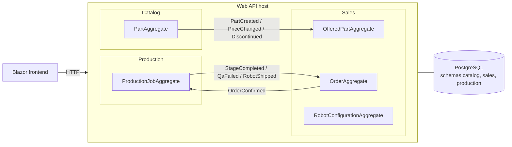

# RoboForge

[](https://github.com/Sztrum/roboforge/actions/workflows/ci.yml)

A robot configurator and production workflow built with .NET 10, Clean
Architecture and DDD. Customers assemble a small robot from catalog parts; the
workshop takes the order through production stages up to shipping.

Project scope, domain model and business rules: [`docs/PROJECT.md`](docs/PROJECT.md).
Architecture decisions: [`docs/ARCHITECTURE.md`](docs/ARCHITECTURE.md).

## What it shows

- **Real DDD:** every business rule (R1–R10 plus value-object and module
  rules) lives in an aggregate, value object or domain service and has a unit
  test. Endpoints and handlers only orchestrate.
- **Bounded contexts that never call each other:** Catalog, Sales and
  Production are separate modules with their own database schema. They talk
  only through integration events written to an outbox in the same
  transaction and published in the background.
- **Production-grade quality:** analyzers as errors, architecture tests that
  enforce layers and module isolation, functional tests against a real
  PostgreSQL, CI with coverage, .NET Aspire with an observability dashboard.

## Architecture



Each arrow between modules is an integration event that goes through the
publishing module's outbox (`OutboxMessages` in its schema). Inside a module
the layers are `UI → Application → Domain` and `Infrastructure → Application`;
see [`docs/ARCHITECTURE.md`](docs/ARCHITECTURE.md).

```
src/
├── AppHost/          Aspire: PostgreSQL + API + frontend + dashboard
├── Web/              API host: composes the modules, ProblemDetails, OpenAPI/Scalar
├── Frontend/         Blazor (interactive server), talks to the API over HTTP
├── Shared/           AggregateRoot, Money, LeadTime, outbox, pipeline behaviours
└── Modules/{Catalog,Sales,Production}/{Module}.{Domain,Application,Infrastructure,UI,IntegrationEvents}
tests/                unit tests per module, architecture tests, functional tests
```

## Requirements

- .NET 10 SDK
- Docker (PostgreSQL runs in a container started by Aspire)

## Run

```bash
dotnet run --project src/AppHost --launch-profile http
```

| What | URL |
| --- | --- |
| Frontend (configurator, orders, workshop) | http://localhost:5050 |
| API reference (Scalar) | http://localhost:5040/scalar |
| Aspire dashboard (logs, traces, metrics) | http://roboforge.dev.localhost:15090 |

On first start the catalog is seeded with 12 parts. Requests for every
endpoint are in [`src/Web/Web.http`](src/Web/Web.http).

## Demo (about 10 minutes)

1. Open the frontend → **Konfigurator** → *Nowa konfiguracja*. Add *Obudowa
   Titan (ASA)*, *Napęd Micro 6V* and *Sterownik Nano 6V*: the quote reports
   **R2** (the drive does not fit the housing) and **R4** (too heavy for the
   drive). Placing the order is refused with both rules.
2. Build a robot that fits, e.g. *Obudowa Titan*, *Napęd Crawler 12V*,
   *Sterownik Edge AI 12V* and *Lidar 360°*: 1656 zł of parts + 15% assembly
   − 5% discount from 1000 zł = **1809,18 zł**, 13 working days.
3. Place the order and confirm it. In the Aspire dashboard, the trace shows
   the request, the outbox and the new production job.
4. **Warsztat**: complete *Druk 3D* and *Montaż*, then fail the QA check once.
   The order page (it refreshes itself) shows the note and 3 more working
   days. Try skipping a stage (**R9**) or failing QA twice (**R10**, job on
   hold).
5. Try to cancel the order while it is in production → refused with **R8**.
6. Finish the stages and ship: the order becomes *Wysłane* with a tracking
   number.
7. Show the green CI run and the architecture tests.

`tests/Web.FunctionalTests/DemoScenarioTest.cs` runs the same flow
automatically.

## Build and test

```bash
dotnet build
dotnet test
```

Functional tests start their own PostgreSQL container through Aspire, so Docker
must be running.

## Based on

- [Clean Architecture Solution Template](https://github.com/jasontaylordev/CleanArchitecture) by Jason Taylor
- DDD patterns from [modular-monolith-with-ddd](https://github.com/kgrzybek/modular-monolith-with-ddd) by Kamil Grzybek
